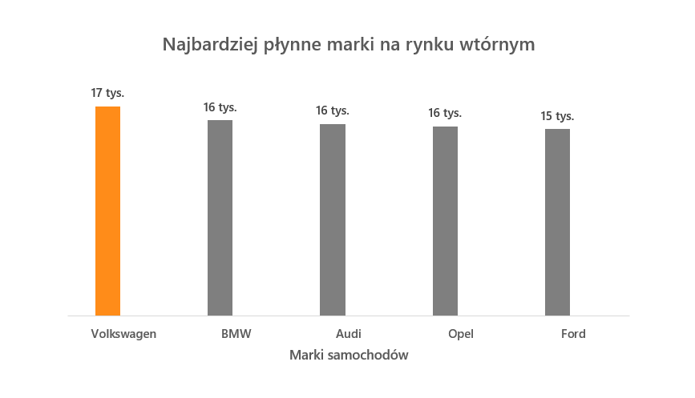
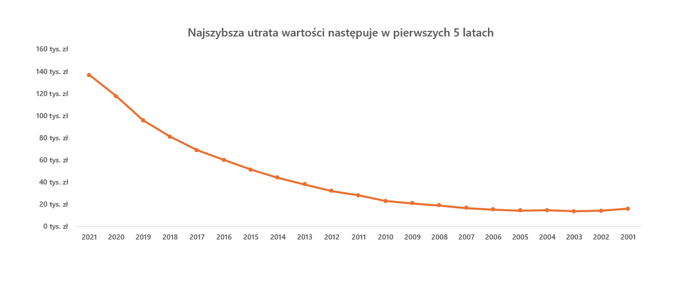
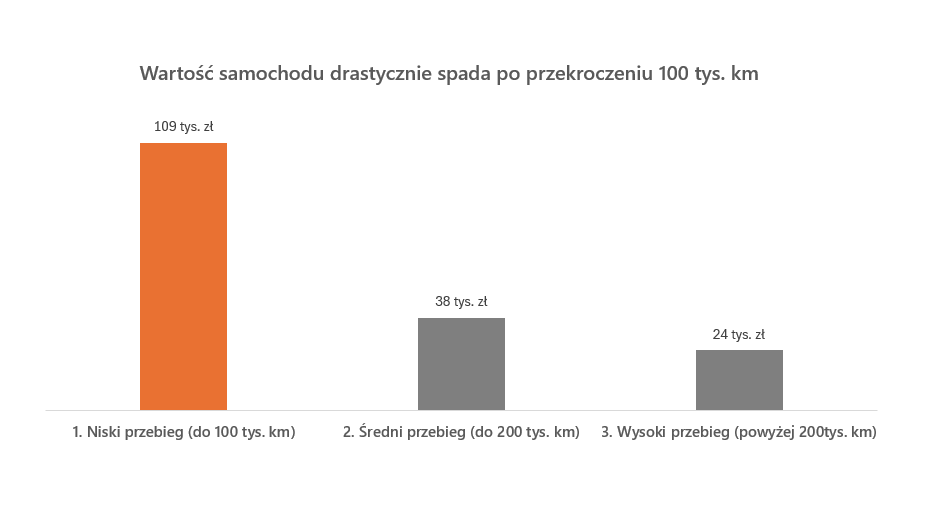

# Polish Used Car Market Analysis

Data analysis of the Polish used car market using SQL and Excel to optimize pricing strategies for local dealerships.

## Business Objective
The main goal of this project is to provide actionable, data-driven insights for local used car dealerships to optimize their pricing models and inventory turnover.

## Data Cleaning & Preparation (SQL)
* Filtered out extreme price anomalies (prices < 5,000 PLN and > 500,000 PLN) to focus on the standard retail market.
* Removed incomplete records containing missing values in crucial columns (mileage, production year).
* Excluded vintage and collector cars (production year before 2000) to prevent market distortion and accurately visualize the standard depreciation curve.

## Key Business Insights & Visualizations (Excel)

### 1. Market Liquidity & Top Brands
German brands completely dominate the secondary market. **Volkswagen** is the undisputed leader in listing volume, guaranteeing the highest inventory turnover for a dealership.

### 2. Depreciation Rate Over Time
Vehicle prices experience the sharpest decline during the first 5 years after production, stabilizing significantly as they approach the 15-year mark.

### 3. The Impact of Mileage on Valuation
Crossing psychological mileage barriers (especially 100k and 200k kilometers) drastically impacts the average valuation of the vehicle.

## Technologies Used
* **SQL (SQLite):** Data cleaning, filtering, segmentation, and aggregation.
* **MS Excel:** Advanced data visualization and business storytelling.
